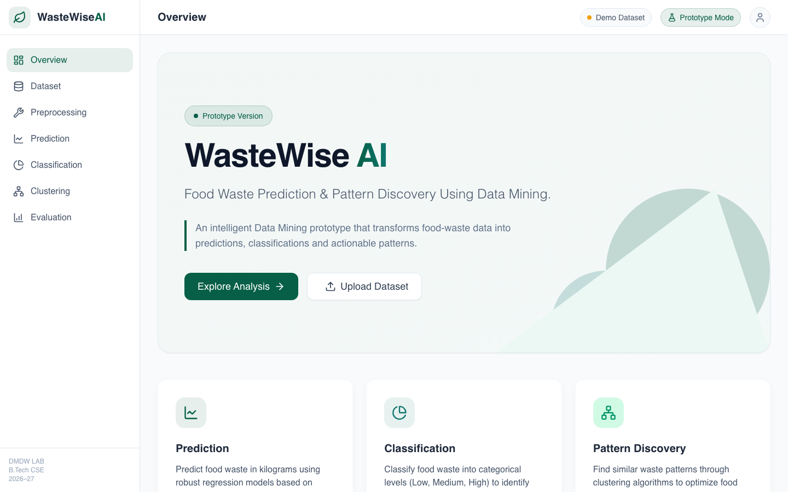
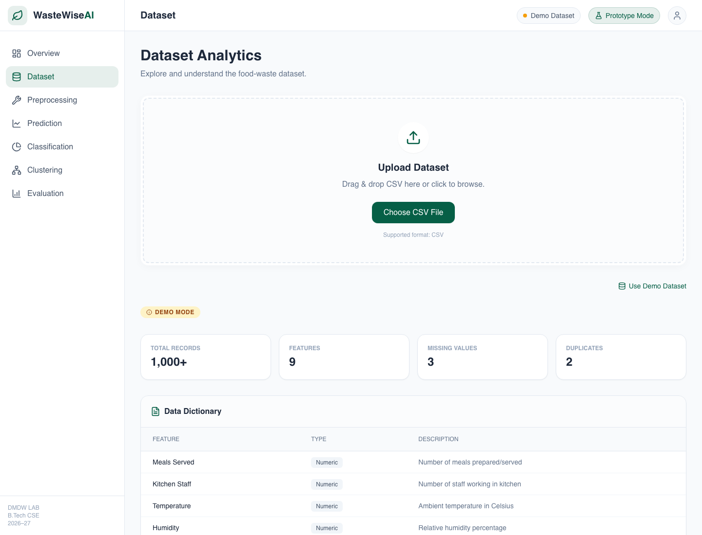
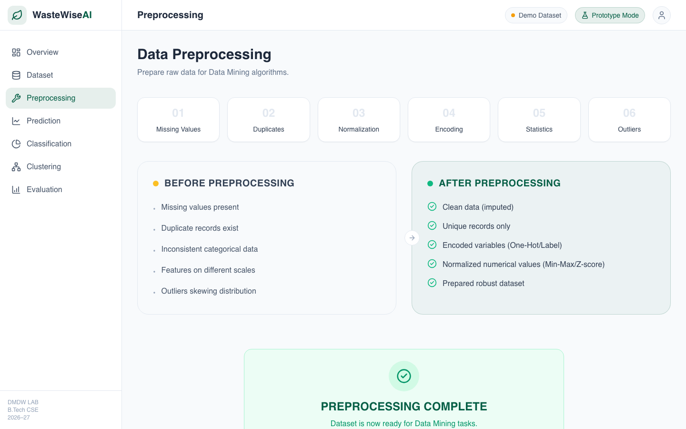
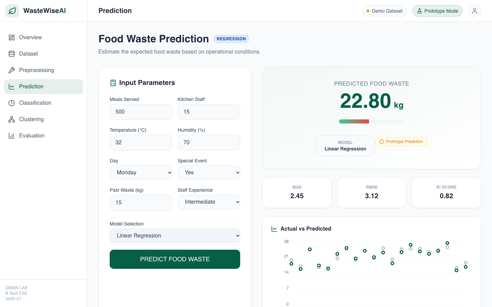
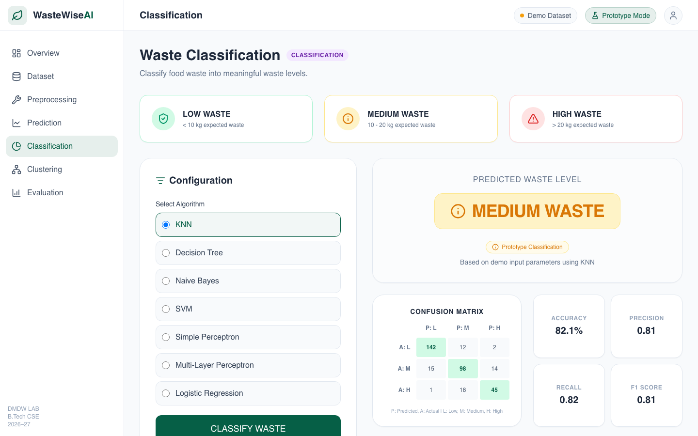
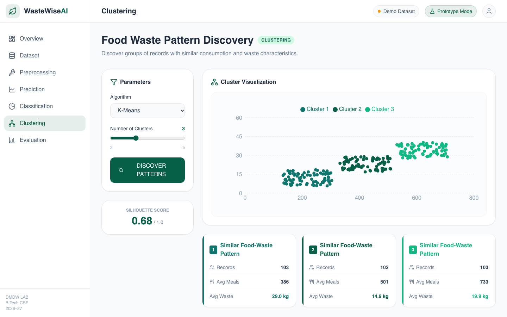
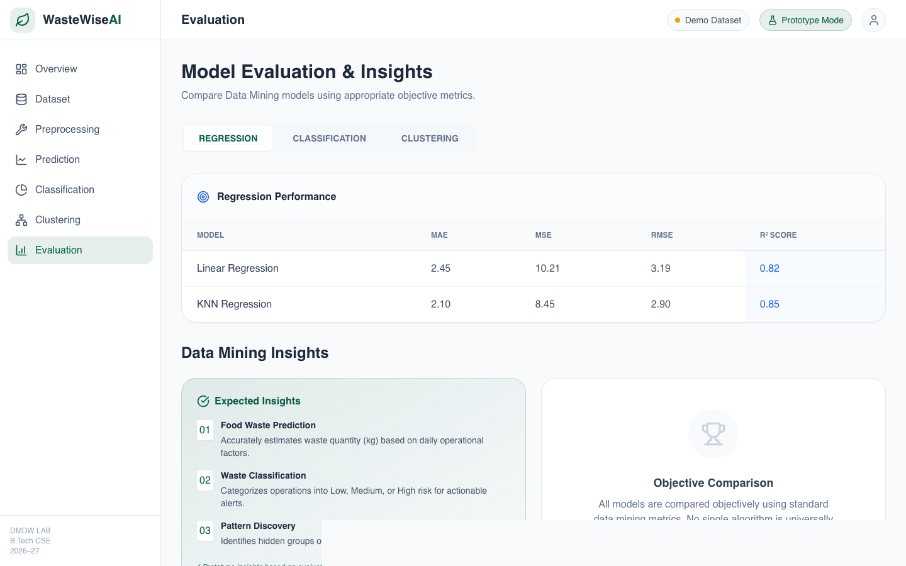

# 🌱 WasteWise AI — Food Waste Prediction & Pattern Discovery

<p align="center">
  
</p>

<p align="center">
  <strong>An Intelligent Data Mining System for Food Waste Forecasting, Risk Classification, and Pattern Discovery</strong>
</p>

<p align="center">
  
  
  
  
  
  
</p>

---

## 📌 Executive Summary

Food waste in institutional cafeterias, event catering, and hospitality dining creates severe financial inefficiency and environmental harm. **WasteWise AI** is an end-to-end Data Mining prototype built to analyze operational parameters—such as meals served, kitchen staffing, ambient weather conditions, event schedules, and historical waste levels—to predict waste outputs, classify waste severity, and identify hidden operational patterns.

Developed as a **Data Mining & Data Warehousing (DMDW)** project, this application provides an interactive web interface demonstrating the complete data science lifecycle from ingestion and cleaning to predictive modeling and unsupervised pattern mining.

---

## 🚀 Key Features & Screenshots

### 1. 📊 Interactive Dashboard & Overview
The landing page provides an immediate overview of the system architecture, core algorithms, and analysis options.

<p align="center">
  
</p>

---

### 2. 📂 Dataset Analytics & Ingestion
- Upload custom operational CSV datasets or use the built-in **1,000+ record demo dataset**.
- Automatic schema validation against required features (`Meals Served`, `Kitchen Staff`, `Temperature`, `Humidity`, `Special Event`, `Past Waste`, `Staff Experience`).
- Real-time data profiling, data dictionary, summary metrics, and distribution histograms.

<p align="center">
  
</p>

---

### 3. 🧹 Automated Preprocessing Pipeline
Demonstrates systematic Data Mining preparation steps before model execution:
- **Missing Value Handling**: Statistical imputation (mean/mode strategies).
- **Duplicate Removal**: Identification and elimination of duplicate records.
- **Encoding**: Transformation of categorical features (Day, Special Event, Staff Experience).
- **Normalization**: Min-Max feature scaling and Z-score standardization.
- **Outlier Detection**: Interquartile Range (IQR) filtering.
- Visual side-by-side **Before vs. After Preprocessing** comparison metrics.

<p align="center">
  
</p>

---

### 4. 📈 Regression: Food Waste Prediction
Estimate numerical expected waste in kilograms (`kg`) based on real-time operational conditions:
- **Models**: Linear Regression, KNN Regression.
- **Interactive Simulator**: Modify meals served, temperature, event status, and staff experience to obtain real-time waste estimates.
- **Visualizations**: Actual vs. Predicted trend comparisons and performance metrics ($R^2$, MAE, RMSE).

<p align="center">
  
</p>

---

### 5. 🏷️ Waste Risk Classification
Categorize operational days into actionable risk tiers:
- **Tiers**:
  - 🟢 **Low Waste** ($< 10\text{ kg}$)
  - 🟡 **Medium Waste** ($10 - 20\text{ kg}$)
  - 🔴 **High Waste** ($> 20\text{ kg}$)
- **Evaluated Algorithms**:
  - K-Nearest Neighbors (KNN)
  - Decision Tree
  - Naïve Bayes
  - Support Vector Machines (SVM)
  - Simple Perceptron
  - Multi-Layer Perceptron (MLP)
  - Logistic Regression
- **Evaluation**: Interactive confusion matrix, Accuracy, Precision, Recall, and F1-Score breakdown.

<p align="center">
  
</p>

---

### 6. 🔍 Pattern Discovery (Unsupervised Clustering)
Discover natural groupings of service operations to isolate waste-generating behaviors:
- **Algorithms**: K-Means Clustering, Hierarchical Agglomerative Clustering, Gaussian Mixture Models (EM/GMM).
- **Cluster Insights**: Silhouette score validation ($0.68$), multi-cluster scatter visualization (`Meals Served` vs. `Waste kg`), and per-cluster average consumption cards.

<p align="center">
  
</p>

---

### 7. 🏆 Model Evaluation & Comparative Insights
Benchmark and compare all algorithms side-by-side:
- **Regression Benchmarks**: MAE, MSE, RMSE, and $R^2$ Score.
- **Classification Benchmarks**: Accuracy, Precision, Recall, and F1-Score across all 7 classifiers.
- **Clustering Quality**: Cluster counts and Silhouette scores.

<p align="center">
  
</p>

---

## 🛠️ Technology Stack

| Layer | Technology |
|---|---|
| **Frontend Framework** | [React 19](https://react.dev/) + [Vite 8](https://vitejs.dev/) |
| **Styling & Design** | [Tailwind CSS 3.4](https://tailwindcss.com/) + Custom Glassmorphism UI |
| **Data Visualizations** | [Recharts 3.10](https://recharts.org/) |
| **Icons & UI Elements** | [Lucide React](https://lucide.dev/) |
| **Data Parsing** | [PapaParse](https://www.papaparse.com/) |
| **Routing** | [React Router v7](https://reactrouter.com/) |

---

## 📁 Repository Structure

```text
wastewise-food-waste-prediction/
├── public/
├── screenshots/               # Application UI screenshots for documentation
│   ├── overview.png
│   ├── dataset.png
│   ├── preprocessing.png
│   ├── prediction.png
│   ├── classification.png
│   ├── clustering.png
│   └── evaluation.png
├── src/
│   ├── components/
│   │   └── Layout.jsx         # Responsive sidebar & navigation shell
│   ├── data/
│   │   └── demoDataset.js     # Synthetic operational dataset generator
│   ├── pages/
│   │   ├── Overview.jsx       # Landing & feature highlights
│   │   ├── Dataset.jsx        # CSV upload, data dictionary & charts
│   │   ├── Preprocessing.jsx  # Cleaning, scaling, outlier removal
│   │   ├── Prediction.jsx     # Regression modeling & predictions
│   │   ├── Classification.jsx # Multi-class risk classification
│   │   ├── Clustering.jsx     # K-Means & pattern discovery
│   │   └── Evaluation.jsx     # Comparative algorithm metrics
│   ├── App.jsx
│   ├── index.css
│   └── main.jsx
├── index.html
├── package.json
├── tailwind.config.js
├── vite.config.js
└── README.md
```

---

## ⚙️ Getting Started Locally

### Prerequisites
- [Node.js](https://nodejs.org/) (version `v18.0.0` or higher recommended)
- `npm` (version `9+`)

### Installation & Run

1. **Clone the repository:**
   ```bash
   git clone https://github.com/gogabhavyasree/wastewise-food-waste-prediction.git
   cd wastewise-food-waste-prediction
   ```

2. **Install dependencies:**
   ```bash
   npm install
   ```

3. **Start the development server:**
   ```bash
   npm run dev
   ```

4. **Open your browser:**
   Navigate to [http://localhost:5174/](http://localhost:5174/) (or the port specified in terminal).

5. **Build for production:**
   ```bash
   npm run build
   ```

---

## 🔬 Data Mining Concepts Demonstrated

1. **Data Cleaning & Preparation**: Handling nulls, duplicate deduplication, scaling numerical dimensions.
2. **Supervised Regression**: Continuous target variable forecasting (`Food Waste (kg)`).
3. **Supervised Classification**: Categorical risk prediction with confusion matrices and performance metrics.
4. **Unsupervised Clustering**: K-Means clustering, cluster centroid estimation, and silhouette coefficient validation.
5. **Model Evaluation & Validation**: Objective comparative analysis using statistical loss metrics.

---

## 👩‍💻 Author & Attribution

- **Repository**: [gogabhavyasree/wastewise-food-waste-prediction](https://github.com/gogabhavyasree/wastewise-food-waste-prediction)
- **Academic Context**: Data Mining & Data Warehousing (DMDW) Laboratory • B.Tech CSE (2026–27)

---

## 📄 License

This project is licensed under the [MIT License](LICENSE).
